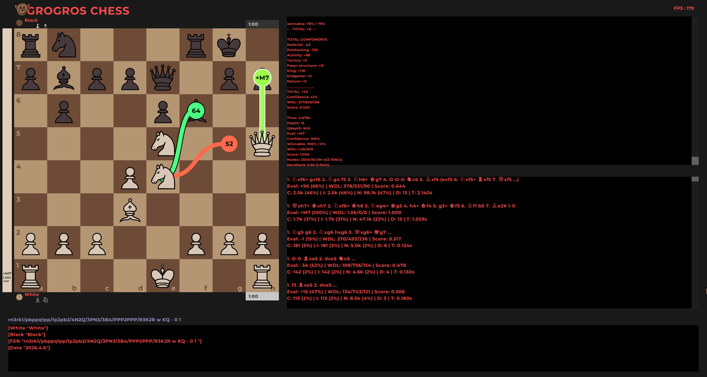
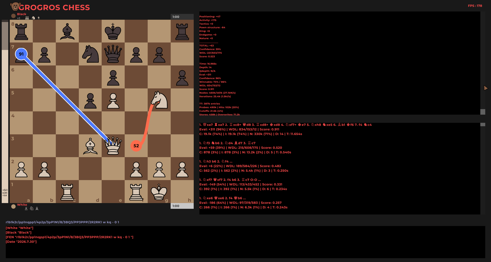
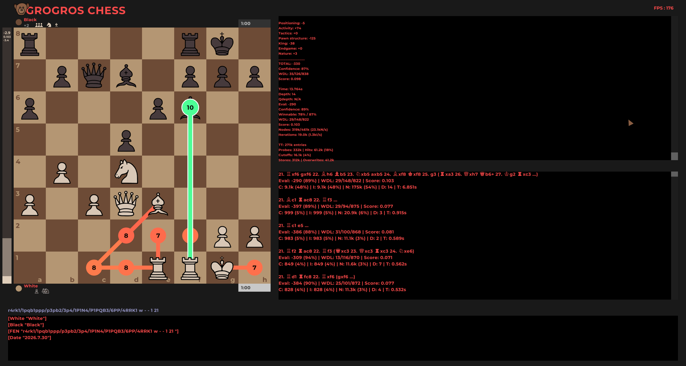
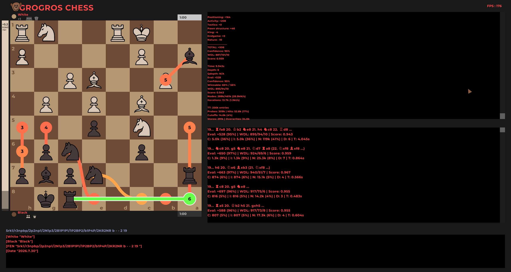

# OptiChess

[](https://github.com/poirouxmartin/opti_chess/actions/workflows/build.yml)
[](LICENSE)
[](https://en.cppreference.com/w/cpp/20)
[](opti_chess/CMakeLists.txt)
[](opti_chess/CMakeLists.txt)



**OptiChess** is a research-oriented chess engine and analysis GUI written in modern C++20, built solo over several years (~23,000 lines). It is centred on **GrogrosZero**, a hybrid search that mixes UCT-style node selection with alpha-beta pruning, an integrated quiescence search, and WDL (win/draw/loss) statistical evaluation.

> **Note:** OptiChess is an experimental project focused on algorithmic research and performance work. It has a minimal UCI loop (see [Headless CLI and UCI](#headless-cli-and-uci)), but it is not a full UCI engine and it is not intended for competitive play. See [Project status](#project-status) for the honest limits.

---

## What is actually interesting here

If you only read one section, read this one — these are the problems the project spends its time on:

- **Two score conventions, one codebase.** Public `Evaluation` values are *white-positive*; negamax, quiescence and the transposition table are *side-to-move*. Every boundary between the two is a conversion, and every missed conversion is a silent evaluation bug. The convention map is documented in [`ALGORITHMS.md`](opti_chess/ALGORITHMS.md).
- **Mate scores must be normalised by ply inside the TT.** A mate-in-N stored at one depth and read at another is wrong unless it is re-based on retrieval. This was a real bug, tracked and fixed — see [`BUGFIXES.md`](opti_chess/BUGFIXES.md).
- **Repetition state is path-local.** The same position reached by two different move orders does not share draw state during exploration, otherwise transpositions corrupt each other's threefold detection.
- **A bounded, zero-allocation search.** `Node` and `Board` objects are drawn from pools sized at startup from available physical memory. When a pool fills, the engine *refines* the existing tree instead of allocating — the process has a memory ceiling by construction.
- **A/B toggles at runtime.** Two experimental search paths (TT in the main search, and a transposition **DAG** instead of a tree) can be switched on and off live with `I` and `O` while the engine runs, so both branches are compared on the same position without a rebuild.

---

## Engine architecture

| Component | Description |
|-----------|-------------|
| **GrogrosZero** | Hybrid search: UCT-style node selection + alpha-beta pruning + quiescence (`exploration_diag.cpp`, declarations in `exploration.h`) |
| **Evaluation** | 30 weights in `Evaluator` — material, mobility, king safety, weak squares, trapped pieces, pawn structure… (`evaluation.h`, `eval_*.cpp`) |
| **Transposition table** | Zobrist-keyed, depth-aware, side-to-move scores (`zobrist.cpp`) |
| **Move generation** | Legal generation from the array board with bitboards for attacks, pins and checks (`movegen.cpp`, `board.cpp`, `board_fen.cpp`) |
| **Memory management** | Preallocated pools (`NodeBuffer`, `BoardBuffer`) — no heap allocation in the search hot path (`buffer.cpp`) |
| **GUI** | raylib analysis board: variations, evaluation graph, game tree (`gui.cpp`) |
| **Neural network** | Small MLP with random weights; not used by the evaluation (`neural_network.cpp`) |

A deeper, implementation-level account lives in [`docs/ARCHITECTURE.md`](docs/ARCHITECTURE.md).

---

## Tech stack

| Technology | Purpose |
|------------|---------|
| **C++20** | Language standard (`cxx_std_20`) |
| **CMake 3.24+** | Build system, with presets for Debug/Release |
| **raylib 5.5** | GUI: board rendering, input, fonts, shaders, sound |
| **tsl::robin_map 1.3** | Hash maps for the transposition table and node children |
| **GoogleTest 1.14** | Test framework for `opti_chess_tests` |

Dependencies are fetched and pinned by CMake `FetchContent` — nothing to install by hand, and no third-party source in the repository.

---

## Building and running

### Prerequisites

- Windows 10/11 x64
- Visual Studio 2022 or newer with the **Desktop development with C++** workload (the local tree is generated by Visual Studio 18 Insiders, whose bundled `cmake.exe` is used)
- CMake 3.24 or later, and Git (CMake uses it to fetch dependencies on the first configure)
- Network access on the first configure only

### Build

All build commands run from the `opti_chess/` subdirectory, which is where `CMakeLists.txt` and `CMakePresets.json` live:

```powershell
cd opti_chess

# Release
cmake --preset windows-release
cmake --build --preset windows-release
.\build\windows-release\Release\opti_chess.exe

# Debug
cmake --preset windows-debug
cmake --build --preset windows-debug
.\build\windows-debug\Debug\opti_chess.exe
```

The first build fetches and compiles raylib from source. CMake copies `resources/` next to the executable after each build, so the binary runs directly from its output directory.

The `opti_chess` executable opens the analysis GUI. The test suite and the headless CLI are separate targets:

```powershell
cmake --build --preset windows-release --target opti_chess_tests opti_chess_cli
.\build\windows-release\Release\opti_chess_cli.exe perft-suite quick
```

---

## Controls

OptiChess is driven from the keyboard once the board is open. The most useful bindings:

| Key | Action |
|-----|--------|
| `G` | Start / stop GrogrosZero analysis on the current position |
| `P` | Play the move GrogrosZero recommends |
| `←` / `→` | Step backward / forward through the game tree |
| `F` | Flip the board |
| `V` | Load a FEN from the clipboard |
| `X` / `C` | Copy the current FEN / PGN to the clipboard |
| `E` | Print the full evaluation breakdown to the console |
| `Space` | Start / stop the clock |
| `Ctrl` + `↑` / `↓` | Toggle GrogrosZero as the white / black player |
| `Del` | Clear the transposition table and the DAG |
| `I` / `O` | A/B toggle: TT in the main search / transposition DAG |
| `H` | Toggle arrow drawing and the on-screen controls panel |
| `T` | Run the built-in test suite (see below) |
| `Z` | Print the Zobrist key of the current position |
| `Ctrl` + `T` | Locate a chessboard on screen and bind to it, reading it live (see below) |
| `Ctrl` + `Q` | Toggle full binding: read every move of the game, not just the opponent's |
| `Ctrl` + `A` | Enable input injection: auto-play the engine's move on the bound board (Play-Computer games only, off by default) |

---

## Screen binding (Windows)

The engine can locate a chessboard rendered on screen and read the position from it, so a
game being played in a browser can be followed live without any integration with the site.

**How it works.** `locate_chessboard()` scans the screen for a board matching a known
`ChessSite` colour profile — light and dark square colours, piece colours, and the highlight
colour of the square just played. `bind_board_orientation()` then decides which side is at
the bottom, and `get_board_move()` samples one pixel per square to rebuild the position and
detect the move that was played. All of it works on the rendered image: no browser
extension, no network interception, no reading of another process's memory.

**What it is for.** The engine analyses the position as the game is played, so its evaluation
and its candidate moves can be compared, move by move, with what the players do and with what
other engines say. It turns any game on screen into a live test position for the evaluator,
which is considerably more interesting than a static FEN.

**Playing.** `click_move()` plays the engine's move with the mouse. It exists for one case:
engine-versus-engine games against the bots hosted on Chess.com, which issues no bot accounts
and exposes no bot API — I asked. Chess.com's Fair Play Policy covers this case explicitly: it
"does not apply to games that are not against other users, such as in the game mode versus
Chess.com computer (i.e. non-human, virtual) 'bots'", and lists games against the computer
personalities among its exceptions, where you are "free to experiment with whatever tools and
learn however you choose" ([Fair Play Policy](https://www.chess.com/legal/fair-play)). It is
never used in games against human opponents, rated or not. Where sanctioned automated play
against humans is available, that is the channel used instead: Lichess issues bot accounts and
exposes an API, and this engine has played there as
[Grogros_Zero](https://lichess.org/@/Grogros_Zero), though the bot is not run continuously. The
input path is off by default and has to be enabled explicitly at runtime.

---

## Headless CLI and UCI

`opti_chess_cli` runs without a window:

```text
opti_chess_cli perft <depth> [fen...]
opti_chess_cli divide <depth> [fen...]
opti_chess_cli perft-suite [quick|full]
opti_chess_cli bench [iterations]
opti_chess_cli uci
```

- `perft` counts the leaf nodes at a depth. `divide` prints the count under each root move, in UCI notation.
- `perft-suite` checks the standard perft positions against reference counts and exits with status 1 on a mismatch.
- `bench` runs a fixed set of positions with `OPTI_SEED=42` (unless the variable is already set) and prints nodes per second and a signature of the results.
- `uci` is a minimal UCI loop: `uci`, `isready`, `ucinewgame`, `position startpos` or `position fen <FEN>` followed by optional `moves ...`, `go`, and `quit`. `go` accepts `nodes`, `movetime`, `wtime`/`btime`/`winc`/`binc` and `infinite`; with none of them it searches 2000 iterations. The budget takes `nodes` first, then `movetime`, then the clock, then `infinite`. `go` is synchronous, and `stop` is ignored.

Example session (full FEN with clocks):

```text
uci
isready
position startpos moves e2e4 e7e5
go nodes 500
position fen 4k3/8/8/K2pP2r/8/8/8/8 w - d6 0 1
go nodes 200
quit
```

The replies include `uciok`, `readyok`, `info nodes ...` and `bestmove <move>`.

---

## Testing

**Automated tests** are a GoogleTest executable, `opti_chess_tests.exe`, built from `tests/unit_test.cpp`. Run the fast set from the release build:

```powershell
.\build\windows-release\Release\opti_chess_tests.exe --gtest_filter="-*Debug*:*Perf*"
```

CI runs ctest with this exclusion regex (the long benchmarks are left out):

```text
ctest --test-dir build/windows-release -C Release --output-on-failure -E "Debug\.|Perf\.|LichessBenchmark|CalibratedBatch|TestsTxtBatch|TimeBudgetLadder|ScalingBenchmark|TimeBenchmark|GuiLikeBench|ParamSweep|OFFvsDAG"
```

CI also runs `Puzzle.LichessBenchmark5000` as a GATE-500 check, which fails if fewer than 400 puzzles are solved.

**Perft.** Move generation is checked against reference node counts from [chessprogramming.org](https://www.chessprogramming.org/Perft_Results), not from the engine itself. `opti_chess_cli perft-suite` covers the start position, Kiwipete, positions 3 to 6 and a promotion-heavy position; it must report 7/7. `full` mode searches deeper than `quick`.

**Harness.** `scripts/harness.ps1` builds the tests, the GUI and the CLI from one tree, then runs `perft-suite`, the gtest set, a UCI smoke session and `bench`. Options: `-NoBuild`, `-NoGtest`, `-Full`, `-BenchIters 2000`. `scripts/perf_compare.ps1 -A old.exe -B new.exe` gives interleaved A/B medians for perft and bench.

**Legacy in-GUI suite.** Pressing `T` in the GUI runs the older suite in `tests.cpp`, which reads `Tests.txt` at runtime (additional puzzles can be appended there). It is not part of CI.

---

## Project structure

```
.
├── README.md
├── LICENSE
├── CONTRIBUTING.md
├── docs/                    # AUDIT.md, AUDIT_TODO.md, ARCHITECTURE.md
├── scripts/                 # harness.ps1, perf_compare.ps1, Lichess download scripts
├── .github/workflows/       # build.yml (CI)
└── opti_chess/
    ├── CMakeLists.txt       # Targets, FetchContent dependencies, post-build resource copy
    ├── CMakePresets.json    # windows-release / windows-debug presets
    ├── main.cpp             # GUI entry point
    ├── main_gui.h           # Application loop, input handling, engine actions
    ├── board.cpp/h          # Board state, bitboards, make_move, hashing
    ├── board_fen.cpp        # FEN import and export
    ├── board_display.cpp    # Console printing, SAN labels
    ├── movegen.cpp          # Legal move generation
    ├── exploration_diag.cpp # GrogrosZero search, quiescence, node tree and DAG
    ├── exploration.h        # Node, ChildLink, search globals and buffers
    ├── evaluation.cpp/h     # Evaluator weights and the Evaluation result
    ├── eval_core/king/pawn/mobility/misc.cpp  # Evaluation terms
    ├── zobrist.cpp/h        # Zobrist keys and transposition table
    ├── buffer.cpp/h         # Node and Board memory pools
    ├── game_tree.cpp/h      # Played variations, independent of the search tree
    ├── gui.cpp/h            # raylib interface
    ├── neural_network.cpp/h # Small MLP with random weights, not used by the evaluation
    ├── puzzle.cpp/h         # PuzzleRunner: headless search driver for tests and the CLI
    ├── stockfish_adapter.cpp/h  # Subprocess client to an external Stockfish
    ├── cli.cpp              # opti_chess_cli: perft, divide, perft-suite, bench, uci
    ├── selfplay.cpp         # opti_chess_selfplay: search parameter matches
    ├── tests.cpp/h          # Legacy in-GUI suite (perft, evaluation, puzzles)
    ├── windows_tests.cpp/h  # Win32 layer: physical memory probe, screen binding (see above)
    ├── useful_functions.cpp/h
    ├── tests/unit_test.cpp  # GoogleTest suite (opti_chess_tests)
    ├── ALGORITHMS.md        # Algorithm reference
    ├── BUGFIXES.md          # Bug ledger
    ├── BENCHMARKS.md        # Benchmark notes
    ├── ROADMAP.md, TODO_list.txt, Tests.txt
    ├── docs/                # DEVELOPMENT.md, older ARCHITECTURE.md
    └── resources/           # Images, fonts, sounds, shaders, opening book
```

---

## Performance and memory model

Search speed is the main design constraint, and it drives most of the structural choices:

- **No heap allocation in the search hot path** — nodes and boards come from pools allocated once at startup.
- **No virtual functions** anywhere in the codebase, so search and evaluation make no virtual calls.
- **Compile-time constants** wherever the value allows it (constexpr attack tables, direction tables and limits in `board.h`).
- **A memory ceiling by construction** — pool capacity is derived from available physical memory and capped; a full pool deepens the existing tree instead of growing.
- **Cache-conscious layout** for the structures touched on every node.

Benchmarks are reproducible from the repository: `perft-suite full` and `bench` through `scripts/perf_compare.ps1`. Node counts and the bench signature are deterministic; nodes per second depend on the machine and on background load, so the audit's before/after numbers are medians over interleaved runs (see [`docs/AUDIT.md`](docs/AUDIT.md), section 6). Profiling before and after any change to `exploration_diag.cpp`, `eval_*.cpp` or `movegen.cpp` is the working rule.

---

## Documentation

| File | Contents |
|------|----------|
| [`docs/ARCHITECTURE.md`](docs/ARCHITECTURE.md) | Architecture: build targets, board representation, move generation, search, evaluation, memory model, tools, known limitations |
| [`opti_chess/docs/DEVELOPMENT.md`](opti_chess/docs/DEVELOPMENT.md) | Build, run, validate, troubleshoot |
| [`opti_chess/docs/ARCHITECTURE.md`](opti_chess/docs/ARCHITECTURE.md) | Older architecture note, superseded by `docs/ARCHITECTURE.md`, kept for history |
| [`opti_chess/ALGORITHMS.md`](opti_chess/ALGORITHMS.md) | Implementation-level reference: sign conventions, mate encoding, `Node` invariants, GrogrosZero loop, quiescence, TT semantics |
| [`opti_chess/BUGFIXES.md`](opti_chess/BUGFIXES.md) | Ledger of algorithmic bugs — symptom, root cause, fix — including the ones still open, ranked by severity |
| [`docs/BENCHMARKS.md`](docs/BENCHMARKS.md) | Reproducible perft and bench numbers, before/after each optimisation |
| [`opti_chess/BENCHMARKS.md`](opti_chess/BENCHMARKS.md) | Older benchmark notes |
| [`docs/AUDIT.md`](docs/AUDIT.md) | Engine audit of 2026-10-12: architecture map, bug table with status, headless harness, before/after speed, structure decision |
| [`docs/AUDIT_TODO.md`](docs/AUDIT_TODO.md) | TODO and FIXME inventory with file and line |
| [`CONTRIBUTING.md`](CONTRIBUTING.md) | Conventions and expectations for changes |

Most of the documentation is in English. Some source comments are still in French (for example in `exploration_diag.cpp`), and the two personal working notes listed under [Project status](#project-status) are in French.

---

## Screenshots

There is one analysis screen. The board carries the search's candidate moves as arrows scored by win rate; the right column holds the evaluation breakdown, the search and transposition-table statistics, and the ranked variations; the PGN of the game tree sits at the bottom. The three captures below are that same screen on three positions taken from the test suite (`tests.cpp`).

**A tactical position — the search finds `1.Qxa7`, the move the suite expects here**



Evaluation `+311` at 96% confidence, WDL `834/153/12`, depth 14, 460k nodes at 27.1 kN/s. The transposition-table panel reports 387k entries and a 20% hit rate over 490k probes, against 71.2k overwrites.

**A middlegame position the engine judges lost for the side to move**



White to move at WDL `29/148/822` — 2.9% winning chances against 82.2% losing. The search still ranks the exchange sacrifice `21.Rxf6` first, ahead of the quiet alternatives: the ranking is driven by win rate, not by material.

**A trapped-piece reference position, seen from Black's side**



The bishop on a2 is trapped in White's camp. The evaluator returns `+506` with WDL `887/101/10`, inside the `[300, 600]` band and the `[0.85, 0.95]` win-rate band that the evaluation test asserts for this position.

> Captured from the current build with the in-app screenshot key (`TAB`).

---

## Project status

Stated plainly, so nothing here is a surprise:

- **Windows only.** The CMake file carries Linux and macOS branches, but the Win32 integration layer (`windows_tests.*`, and console setup in `main_gui.h`) is not yet abstracted, so those targets do not compile today.
- **UCI is minimal.** `opti_chess_cli uci` covers the commands listed above and nothing more (no `stop`, no streamed search info). The engine is not rated on a public list. Engine-vs-engine matches are the `selfplay.cpp` parameter matches; the optional click-based play path is described in [Screen binding](#screen-binding-windows).
- **Automated tests exist, but coverage is partial.** `opti_chess_tests` (GoogleTest) runs in CI on push to `main` and on pull requests, together with the GATE-500 puzzle check. The GUI itself is still checked by hand, and the in-GUI `T` suite is legacy.
- **`board.cpp` is still the largest engine file.** Move generation was split out into `movegen.cpp`; further splits are proposed in [`docs/AUDIT.md`](docs/AUDIT.md) (section 7).
- **Two working files are still in French**: `TODO_list.txt`, the development backlog, and the annotations in `Tests.txt`. They are personal working notes rather than documentation.
- **Known open engine bugs are tracked publicly** in [`BUGFIXES.md`](opti_chess/BUGFIXES.md) and [`docs/AUDIT.md`](docs/AUDIT.md) rather than left implicit.

---

## License

Released under the [MIT License](LICENSE).
